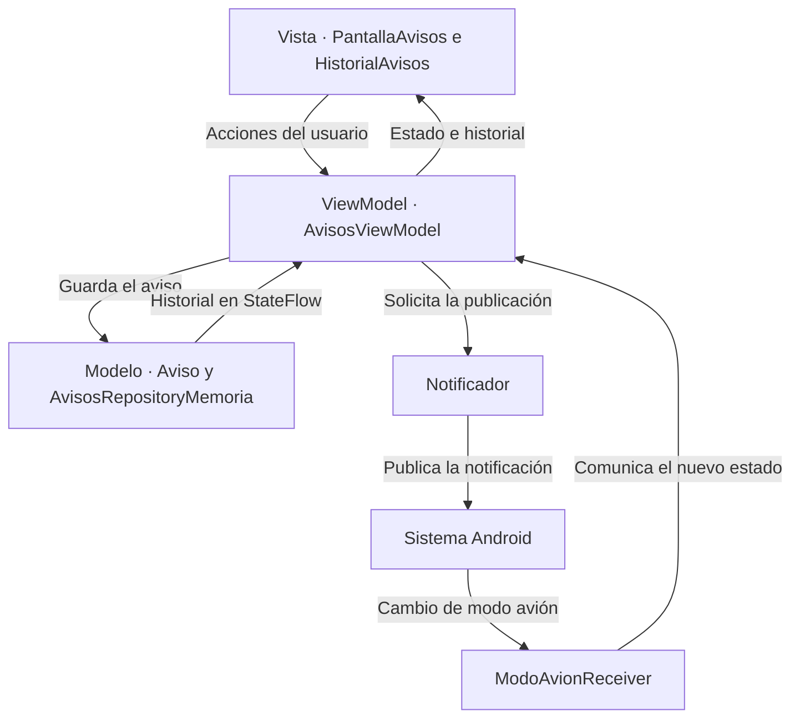
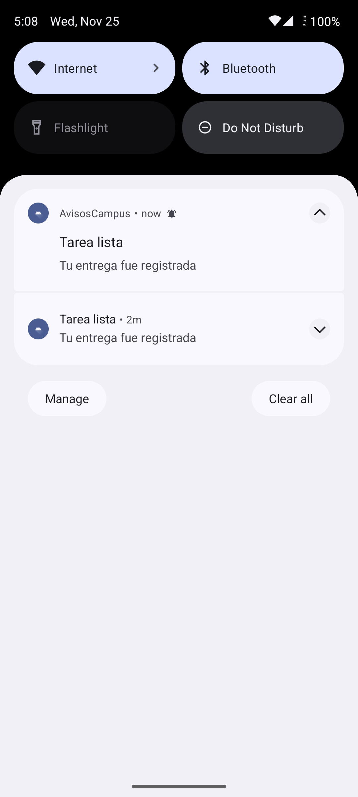
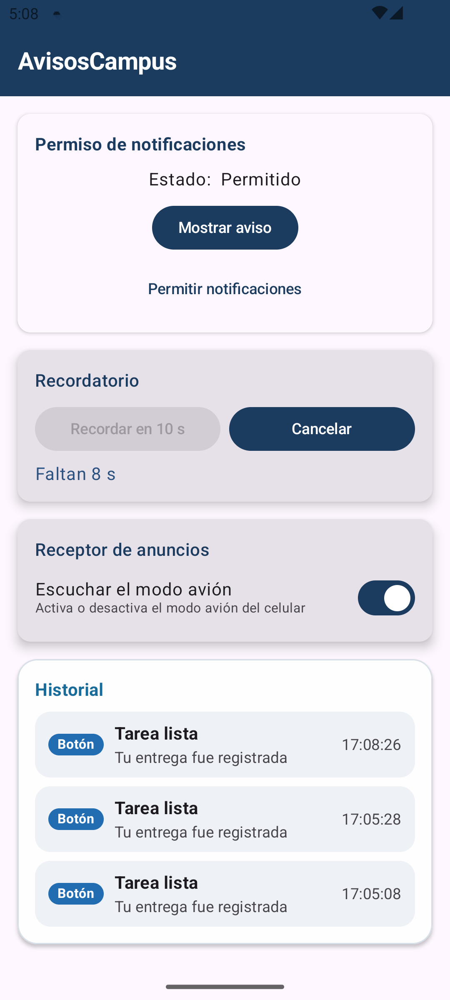
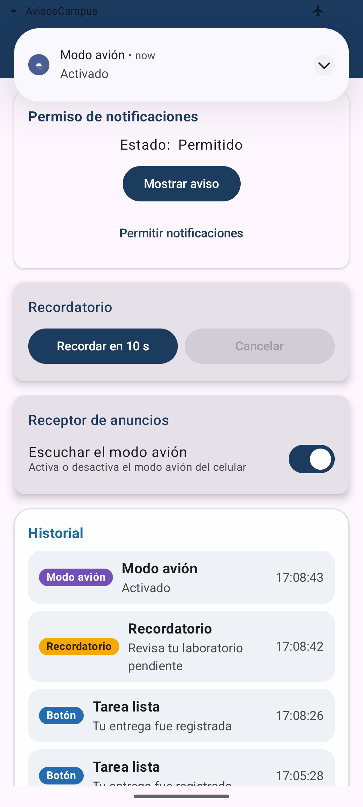
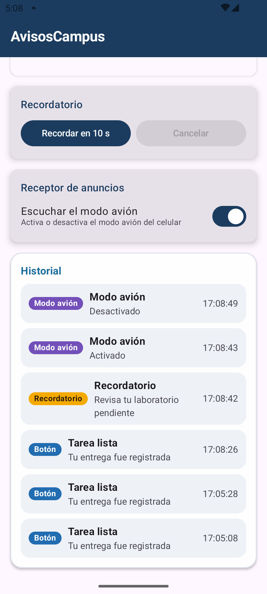
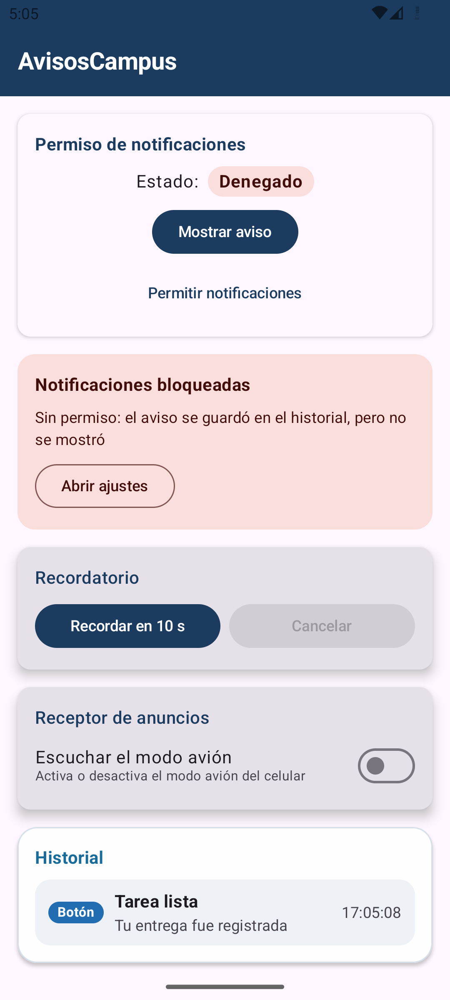

# AvisosCampus

AvisosCampus es una aplicación Android hecha con Kotlin y Jetpack Compose para practicar notificaciones locales. Permite generar un aviso al pulsar un botón, iniciar o cancelar un recordatorio de 10 segundos y recibir avisos al activar o desactivar el modo avión.

El Historial muestra los 20 avisos más recientes, con el último arriba. Cada fila incluye el origen, el título, el mensaje y la hora. El historial se mantiene en memoria y se conserva al girar la pantalla. Si el permiso de notificaciones está bloqueado, el aviso queda registrado y la app ofrece un acceso a Ajustes.

## Árbol de paquetes

Paquete base `com.carbajal.avisoscampus`, ubicado en `app/src/main/java`.

```text
com.carbajal.avisoscampus/
├── AvisosApp.kt
├── MainActivity.kt
├── data/
│   └── AvisosRepository.kt
├── model/
│   └── Modelos.kt
├── notificacion/
│   └── Notificador.kt
├── receiver/
│   └── ModoAvionReceiver.kt
├── ui/
│   ├── HistorialAvisos.kt
│   ├── PantallaAvisos.kt
│   └── theme/
│       ├── Color.kt
│       ├── Theme.kt
│       └── Type.kt
└── viewmodel/
    ├── AvisosViewModel.kt
    └── AvisosViewModelFactory.kt
```

## Diagrama MVVM



`AvisosApp` crea los canales al iniciar. El ViewModel coordina el recordatorio y guarda cada aviso antes de pedirle a `Notificador` que lo publique. La pantalla observa el historial, el permiso, la cuenta regresiva y el mensaje de error.

## Capturas

Capturas reales de AvisosCampus en un emulador con Android 14.

<table>
  <tr>
    <td align="center" width="33%"><strong>Notificación en el panel</strong><br></td>
    <td align="center" width="33%"><strong>Recordatorio</strong><br></td>
    <td align="center" width="33%"><strong>Modo avión</strong><br></td>
  </tr>
  <tr>
    <td align="center"><strong>Historial</strong><br></td>
    <td align="center"><strong>Permiso denegado</strong><br></td>
    <td></td>
  </tr>
</table>

## Para pensar

1. **¿Por qué una notificación necesita un canal y un permiso? ¿Qué pasa si falta cada uno?**

   Desde Android 8, el canal agrupa los avisos y permite controlar su importancia, sonido y visibilidad. Si falta el canal para una app que lo requiere, Android descarta la notificación y registra un error. Desde Android 13, `POST_NOTIFICATIONS` permite que el usuario autorice las notificaciones de la app. Si se deniega, Android bloquea los avisos de AvisosCampus en el panel y la app los conserva en su historial. [Canales de notificación](https://developer.android.com/develop/ui/compose/notifications/channels), [Permiso de notificaciones](https://developer.android.com/develop/ui/compose/notifications/notification-permission)

2. **¿Por qué el ViewModel emite un evento y no muestra la notificación él mismo?**

   En un diseño basado en eventos, el ViewModel comunica que se generó un aviso y delega la interacción con Android. Así, la lógica que decide cuándo avisar se puede probar de forma independiente. En esta implementación, `AvisosViewModel` guarda el aviso y llama directamente a `Notificador`, que contiene la lógica de publicación. La pantalla observa el estado y la publicación puede completarse aunque Compose se esté recreando al girar. [Eventos de la capa de IU](https://developer.android.com/topic/architecture/ui-layer/events)

3. **¿Qué pasa si usas el mismo ID en dos notificaciones?**

   Si ambas publicaciones son de la misma app y usan el mismo ID y la misma etiqueta, la segunda actualiza la tarjeta activa del panel. Si la primera ya se descartó, Android crea una nueva. Para que aparezcan como tarjetas distintas, usa identificadores diferentes. [Actualizar una notificación](https://developer.android.com/develop/ui/compose/notifications/create-notification)

4. **¿Por qué `onReceive` debe ser corto y por qué hay que quitar el receptor al salir?**

   `onReceive` se ejecuta normalmente en el hilo principal. Una operación larga puede bloquear la interfaz y provocar que la app deje de responder. En AvisosCampus, el receptor lee el nuevo estado y lo delega al ViewModel. El ViewModel lo desregistra al apagar el interruptor o cuando se libera en `onCleared()`, para dejar de recibir eventos y liberar las referencias del registro. El uso del contexto de la aplicación permite que la escucha sobreviva a la rotación. [BroadcastReceiver](https://developer.android.com/reference/android/content/BroadcastReceiver), [Registro y desregistro de receptores](https://developer.android.com/develop/background-work/background-tasks/broadcasts)

5. **¿En qué casos usarías una notificación local y en cuáles una push de Firebase?**

   Usaría una **local** cuando el teléfono ya conoce el evento, como el fin del recordatorio o el cambio de modo avión. Usaría una **push de Firebase Cloud Messaging (FCM)** cuando la información nace fuera del dispositivo, como una suspensión de clases o un cambio de aula publicado por el campus. En ese caso, un servidor envía el mensaje a través de FCM y el dispositivo necesita conectividad para recibirlo. [Tipos de mensajes de Firebase Cloud Messaging](https://firebase.google.com/docs/cloud-messaging/customize-messages/set-message-type)
